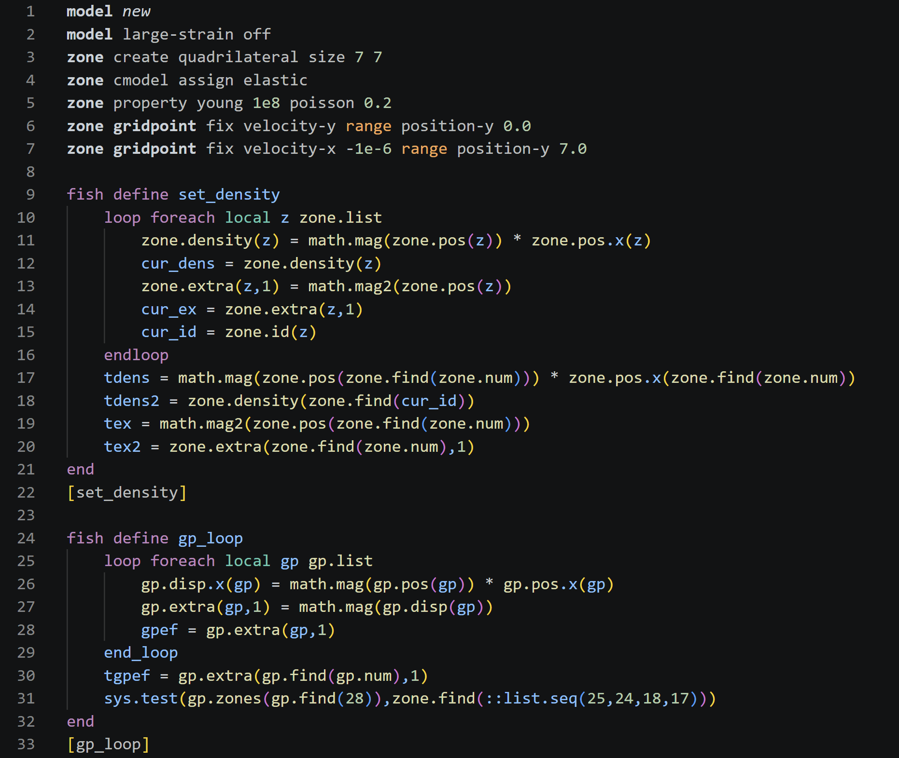

# Itasca FISH

VS Code language extension providing syntax highlighting for the Itasca FISH language used in Itasca codes (FLAC2D/FLAC3D/PFC2D/UDEC/3DEC).

Syntax highlighting targets Itasca software version 7.0 and newer.

## Screenshots

## Features

- Syntax highlighting for `.fis`, `.dat`, `.f3dat`, `.f3fis`, and related Itasca file types
- FISH keywords, flow control, operators, strings, numbers, and comments
- Itasca FISH built-in function name highlighting
- Completion for built-in FISH functions
- Document symbols and folding ranges for FISH blocks
- Command keywords highlighting 

## File Extensions

`.dat`, `.fis`, `.f3dat`, `.f3fis`, `.3ddat`, `.3dfis`, `.p3dat`, `.p2dat`, `.p3fis`, `.p2fis`

## Installation

Install from the VS Code Marketplace or from a `.vsix` package.

## Feedback

Report issues or request features at: [itasca_fish_feedback](https://github.com/HuyTRANcode/itasca_fish_feedback)

## License

MIT
